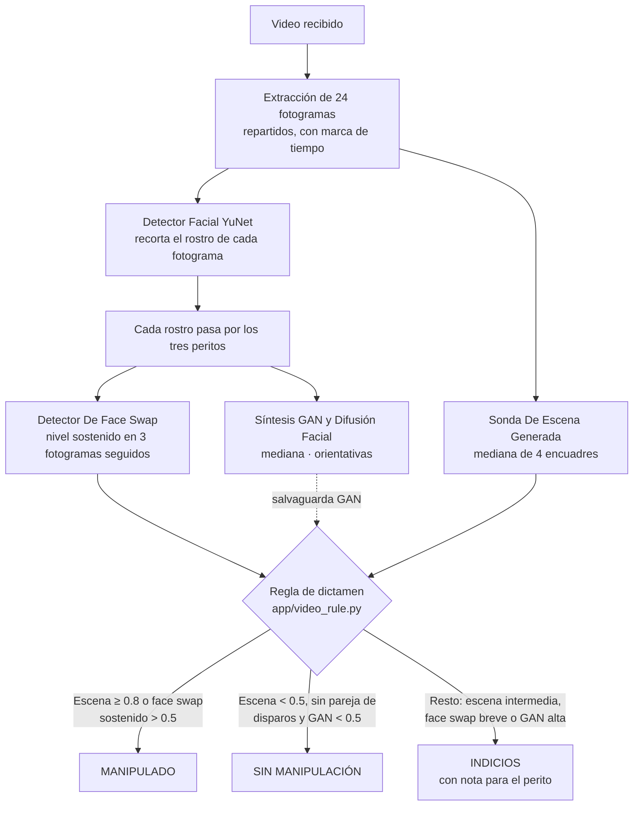

# Modelos Y Procedimiento De Determinación

Este documento describe, paso a paso, cómo CertiFace determina si un video (o
una imagen) es **real** o **falso**, y cataloga cada modelo de este
directorio con su **Nombre Estándar** — formato de escritura con mayúscula
inicial en cada palabra — que es la forma canónica de referirse a ellos en
documentación, informes periciales y comunicación del equipo.

---

## Catálogo De Modelos

| Nombre Estándar | Archivo | Arquitectura | Entrenado Sobre | Función | Licencia |
|---|---|---|---|---|---|
| **Detector Facial YuNet** | `Detector_Facial_YuNet.onnx` (227 KB) | YuNet (DNN, ONNX) | Rostros en contexto general | Localiza y recorta el rostro más grande de cada fotograma | MIT |
| **Detector De Síntesis GAN** | `Detector_De_Sintesis_GAN.pth` (16 MB) | EfficientNet-B0 | 140k Real and Fake Faces (StyleGAN) | Reconoce rostros 100 % sintéticos de GAN clásica | Propio |
| **Detector De Face Swap** | `Detector_De_Face_Swap.pth` (267 MB) | EfficientNet-B7 noisy-student | DFDC — Deepfake Detection Challenge | Reconoce caras intercambiadas en video | MIT ([ganador del DFDC](https://github.com/selimsef/dfdc_deepfake_challenge)) |
| **Detector De Difusión Facial** | `Detector_De_Difusion_Facial/` (355 MB) | SigLIP2 base, 512 px | OpenDeepfake-Preview (rostros de generación moderna) | Reconoce rostros generados por difusión | Apache 2.0 ([origen](https://huggingface.co/prithivMLmods/deepfake-detector-model-v1)) |
| **Sonda De Escena Generada** | `Sonda_De_Escena_Generada/` (2 GB) | SigLIP2-SO400M + DINOv2-L (LoRA fusionado) | OpenFake — ~100k imágenes generales, 25+ generadores | Reconoce generación en el **encuadre completo**, no solo el rostro | MIT ([origen](https://huggingface.co/Bombek1/ai-image-detector-siglip-dinov2)) |

Correspondencia con las claves de la API (`models` en la respuesta de
`POST /predict`):

| Nombre Estándar | Clave API | Etiqueta En La Interfaz |
|---|---|---|
| Detector De Síntesis GAN | `synthesis_gan` | GAN |
| Detector De Face Swap | `faceswap_dfdc` | FACE SWAP |
| Detector De Difusión Facial | `diffusion_modern` | DIFUSIÓN |
| Sonda De Escena Generada | `scene_generated` | ESCENA |

Las mismas claves se usan en `explanation.weights` (la ponderación del mapa
de calor explicativo, Paso 7).

Todos los pesos se cargan desde este directorio en el arranque, en modo
seguro (`torch.load` con `weights_only`); los checkpoints de terceros se
convirtieron una única vez a archivos de solo-tensores. No hay descargas en
tiempo de ejecución.

> ⚠️ **Los tres pesos grandes no se versionan en git** (límite de 100 MB por
> archivo de GitHub). En un clon nuevo, reconstrúyelos con
> `python scripts/fetch_models.py` desde `backend/` — descarga de las fuentes
> oficiales listadas abajo y aplica las mismas conversiones.

## Enlaces De Origen

Procedencia exacta de cada modelo y qué transformación se le aplicó al
incorporarlo:

| Nombre Estándar | Origen | Transformación aplicada |
|---|---|---|
| **Detector Facial YuNet** | [opencv/opencv_zoo — face_detection_yunet](https://github.com/opencv/opencv_zoo/tree/main/models/face_detection_yunet) (archivo `face_detection_yunet_2023mar.onnx`) | Ninguna; se usa el ONNX oficial tal cual |
| **Detector De Síntesis GAN** | Entrenamiento propio en Google Colab sobre el dataset [140k Real and Fake Faces](https://www.kaggle.com/datasets/xhlulu/140k-real-and-fake-faces) (Kaggle, xhlulu) | Ninguna |
| **Detector De Face Swap** | [selimsef/dfdc_deepfake_challenge — release 0.0.1](https://github.com/selimsef/dfdc_deepfake_challenge/releases/tag/0.0.1), checkpoint `final_888_DeepFakeClassifier_tf_efficientnet_b7_ns_0_40` | Convertido a archivo de solo-tensores (el checkpoint original de 2020 traía metadatos numpy incompatibles con el modo seguro de `torch.load`) |
| **Detector De Difusión Facial** | [prithivMLmods/deepfake-detector-model-v1](https://huggingface.co/prithivMLmods/deepfake-detector-model-v1) (Hugging Face) | Se descartaron los checkpoints intermedios de entrenamiento; se conserva solo `model.safetensors` y sus configs |
| **Sonda De Escena Generada** | [Bombek1/ai-image-detector-siglip-dinov2](https://huggingface.co/Bombek1/ai-image-detector-siglip-dinov2) (Hugging Face) | Convertido a solo-tensores; los adaptadores LoRA se fusionan en los backbones al cargar (equivalente en inferencia). Incluye los configs del backbone [google/siglip2-so400m-patch14-384](https://huggingface.co/google/siglip2-so400m-patch14-384) para construir sin red |

---

## Procedimiento De Determinación En Video

### Paso 1 — Ingesta Y Extracción

El video se valida (formato, ≤ 10 MB) y se escriben hasta **24 fotogramas
muestreados a intervalos regulares** de toda la línea de tiempo, cada uno con
su marca de tiempo en segundos. Si OpenCV no puede decodificar el códec, el
análisis se detiene con un error explícito (HTTP 422) — nunca se emite
veredicto sobre material ilegible.

> **Cadena de custodia.** Antes de que el material llegue hasta aquí, la
> aplicación web calcula su huella SHA-256 y la contrasta con la que el perito
> anotó al recibir la evidencia (ver el README raíz). La comprobación es del
> cliente y **no bloquea el análisis**: una discrepancia se advierte y queda
> escrita en el dictamen, pero el procedimiento de determinación que sigue es
> exactamente el mismo. El backend no participa en esa verificación.

### Paso 2 — Recorte Facial

El **Detector Facial YuNet** localiza el rostro más grande de cada fotograma
y lo recorta con un margen del 35 %. Esto es determinante: los peritos fueron
entrenados con rostros que ocupan todo el encuadre, y pasarles el fotograma
entero haría que el fondo dominara el veredicto. Si un fotograma no tiene
rostro detectable se analiza completo y queda registrado; si ningún fotograma
tiene rostro, el dictamen lo advierte (`faces_detected: 0`).

### Paso 3 — Evaluación Por Los Tres Peritos

Cada recorte facial pasa por los tres especialistas, cada uno experto en una
familia de manipulación distinta:

- **Detector De Síntesis GAN** — busca los artefactos de textura de las GAN
  clásicas (StyleGAN).
- **Detector De Face Swap** — busca los bordes de mezcla e inconsistencias
  del intercambio de caras.
- **Detector De Difusión Facial** — busca la firma de los generadores
  modernos por difusión.

Cada uno emite una probabilidad de manipulación **por fotograma**, visible en
el log (`p_gan`, `p_swap`, `p_diff`).

### Paso 4 — Agregación

| Señal | Estadística | Papel | Razón forense |
|---|---|---|---|
| Face Swap | **Nivel sostenido**: el máximo, entre todas las ventanas de 3 fotogramas seguidos con rostro, de la puntuación mínima de la ventana | Decide | Un intercambio de rostro dura todo el plano y dispara el detector en fotogramas consecutivos; sus falsas alarmas en video auténtico (perfiles, rostros pequeños, desenfoque) son picos breves |
| Sonda De Escena | **Mediana de 4 encuadres** repartidos, preferentemente donde el rostro no domina | Decide | Es la única señal que delata el video generado por completo; con 4 lecturas, una aislada alta pesa menos que con 2 |
| Síntesis GAN | Mediana sobre los fotogramas con rostro | Orientativa y salvaguarda | No separa en material de redes; con mediana ≥ 0.5 impide certificar autenticidad, pero no condena |
| Difusión Facial | Mediana sobre los fotogramas con rostro | Orientativa | En material de redes puntúa más alto lo auténtico que lo generado: los filtros y la recompresión imitan su firma |

### Paso 5 — Decisión

La regla vive en `app/video_rule.py`, sin dependencias de los modelos, y la
comparten producción, el script de calibración y las pruebas:

1. **MANIPULADO** si la escena alcanza 0.8 (generación global) o el face swap
   se sostiene por encima de 0.5 en 3 fotogramas seguidos. La confianza es la
   señal que condenó.
2. **SIN MANIPULACIÓN** si la escena está limpia (< 0.5), el face swap no
   encadena ni dos disparos y la mediana GAN queda por debajo de 0.5.
3. **INDICIOS** en el resto, con una nota que explica cada duda: lectura de
   escena intermedia (0.5–0.8), face swap breve (dos fotogramas seguidos) o
   síntesis GAN alta sin corroborar.

Los umbrales salen de la calibración del 2026-11-11 sobre 71 videos de redes
sociales (36 auténticos, 35 manipulados entre face swap y generación
completa), elegidos con validación cruzada dejando uno fuera. Errores graves:
2 auténticos condenados y 1 manipulado certificado, frente a 25 y 0 con la
regla anterior (máximo de los tres peritos). Detalle y procedimiento para
volver a medir: `python -m scripts.calibrate_catalog` (ver el README raíz).

La sonda se ejecuta siempre en video (4 × ~20-27 s en CPU). Las **imágenes**
conservan la cascada anterior (condena corroborada, contraprueba de escena
cuando solo condena la difusión y verificación de todo «Real»), descrita en
`predict_image` de `app/model.py`: el catálogo de calibración no incluía
imágenes.

### Paso 6 — Dictamen

| Sello | Valor API | Significado |
|---|---|---|
| **MANIPULADO** (naranja) | `Fake` | Manipulación detectada, con corroboración o generación global confirmada |
| **INDICIOS** (ámbar, borde discontinuo) | `Suspect` | Señal sin corroborar o inconclusa; el campo `caveat` explica la reserva y el perito decide con las métricas |
| **REAL** (moss) | `Real` | En video: escena limpia y sin face swap sostenido ni breve (GAN y difusión son orientativas). En imagen: los tres peritos limpios. El porcentaje orienta la decisión del perito |

El dictamen incluye siempre el desglose por modelo (la señal decisoria
marcada con ▸), los fotogramas analizados y con rostro, la puntuación por
fotograma (`frame_scores`) y los **momentos sospechosos** con marca de tiempo
(`suspicious_seconds`, fotogramas de face swap > 0.6) para revisión manual
directa en la línea de tiempo.

### Paso 7 — Mapa De Calor Explicativo (EigenCAM)

Para que el perito respalde el dictamen, el sistema genera **un mapa de calor
que fusiona la atención de todos los peritos que participaron**, superpuesto
sobre el fotograma completo. En video no se produce uno solo: se produce
**uno por cada fotograma analizado (los 24)**, cada uno coloreado con la
señal de su propio instante, más el **destacado** — el de mayor señal, el
único que puede incorporar el CAM de la sonda de escena, cuya lectura es
global y no por fotograma. Así el perito no ve una foto fija de la evidencia,
sino cómo evoluciona la atención de los detectores a lo largo del video.
Implementado en `backend/app/explain.py` sin dependencias externas.

**Método.** EigenCAM: primer componente principal (SVD) de las activaciones
de la última capa de cada modelo — sin gradientes, aplicable a CNN y ViT por
igual. Anclajes: `_bn1` + swish del B0 (7×7, el mismo tensor que devuelve
`extract_features`), `encoder.bn2` del B7 (12×12, con el letterbox de entrada
deshecho), `post_layernorm` del SigLIP facial (parches 14×14) y de la torre
SigLIP del ensemble de escena (cuando la sonda participó).

**Coste.** Calcular 24 mapas re-ejecutando los modelos costaría una segunda
pasada de inferencia completa. En su lugar, `FacialCapture` engancha las tres
capas **una sola vez** y congela el EigenCAM de cada fotograma según se
puntúa: lo que se guarda es una rejilla diminuta (7×7, 12×12, 14×14) y el
coste añadido es la SVD por fotograma, del orden de milisegundos. El mapa de
los 24 fotogramas sale, en la práctica, gratis.

**Fusión.** Cada mapa se normaliza 0-1; los faciales se reubican en la caja
del rostro dentro del fotograma completo y el de escena cubre el encuadre
(este último, solo si su lectura fue **relevante para el veredicto** —
≥ 0.5, es decir, confirmó o levantó sospecha; una lectura descartada por la
decisión no pinta el mapa). La fusión es un **máximo ponderado por píxel**:

    fusionado(x) = maxᵢ( wᵢ · camᵢ(x) )

con wᵢ = señal por-fotograma de cada detector. Cada punto refleja así la
evidencia del perito más fuerte en ese punto, en **probabilidad absoluta**,
sin que un promedio la diluya.

**Presentación forense.** La evidencia se convierte a escala de grises
atenuada, de modo que **todo color en el mapa es señal**, nunca color propio
de la imagen. El color codifica la intensidad absoluta con la **escala de
riesgo verde → amarillo → naranja → rojo**: un material auténtico muestra
zonas de atención verdes y suaves; uno manipulado, núcleos rojos. Se
muestran **todas** las zonas de atención (el mapa se suaviza en manchas
orgánicas y solo se descarta el ruido puntual sin área mínima), en degradado
continuo, sin contornos duros; el CAM de escena recibe además un difuminado
agresivo que lava su moteado característico. Recuadro naranja en el rostro
analizado.

La zona se dibuja **siempre que haya atención, por débil que sea la señal**:
lo que cambia con la intensidad es el color (y algo la opacidad), no la
existencia del mapa. Esto es deliberado — un suelo de intensidad alto dejaba
los fotogramas auténticos en gris, sin una sola mancha, y el perito no podía
distinguir «riesgo bajo» de «el mapa no funciona». Que un material auténtico
salga en verde **es** el resultado correcto.

El resultado viaja en el campo `explanation` de la respuesta: el destacado
(JPEG base64, lado ≤ 720 px) más `frames[]`, un mapa por fotograma analizado
(lado ≤ 640 px) con su segundo, su señal y sus ponderaciones. La interfaz
muestra el destacado en grande y la tira completa debajo, recorrible. Un
fallo del mapa —de uno o de todos— nunca afecta al veredicto.

### Imágenes

El procedimiento es el mismo con un solo "fotograma": recorte facial, tres
peritos, y las mismas reglas de reserva y zona gris usando la imagen completa
como encuadre para la Sonda De Escena Generada.

---

## Límites Declarados

Cada perito conoce su familia y su época. Manipulaciones de familias no
vistas en entrenamiento —face swap comercial de última generación,
reenactment, generadores futuros— pueden atenuarse hasta la zona gris o
escapar. El diseño de tres sellos garantiza que la incertidumbre nunca se
presenta como certeza: cuando el sistema no puede corroborar, lo dice
(**INDICIOS**) y entrega las métricas para que decida el perito.
