# CertiFace: almacén forense seguro en S3 / Cloudflare R2

## 1. Estado de la implementación

Se configuró el backend para usar el bucket indicado mediante la API compatible
con S3 de Cloudflare R2. Las credenciales están únicamente en `backend/.env`,
excluido de Git y protegido mediante permisos del sistema operativo.

**Configuración comprobada en el proveedor:**

- Acceso público `r2.dev`: deshabilitado.
- Dominios públicos personalizados: ninguno habilitado.
- Regla `certiface-forensic-indefinite`: habilitada, con retención indefinida
  para `certiface/v1/`. Se conservaron las reglas existentes de otros prefijos.
- Un objeto sintético cifrado pudo subirse, recuperarse y verificarse.
- R2 rechazó su sobrescritura y eliminación con `ObjectLockedByBucketPolicy`.
- Se aplicó una migración aditiva a PostgreSQL y se verificó que sus triggers
  rechazan mutaciones; las transacciones sintéticas de comprobación se revirtieron.

El secreto S3 inicial no correspondía al token activo. Se sincronizó en el `.env`
con la derivación oficial de R2: ID del token para el acceso y SHA-256 de su valor
para el secreto. No se incluyeron valores privados en esta documentación.

`USE_LOCAL_STORAGE=false` selecciona R2. Mantenerlo en `true` habría seleccionado
el adaptador local, por lo que se cambió expresamente para cumplir esta integración.
No existe un fallback automático a disco si R2 falla.

## 2. Qué significa “inmodificable” en este sistema

Hay varias protecciones independientes:

1. **Retención del proveedor:** Bucket Lock bloquea sobrescrituras y borrados de
   objetos cubiertos por la regla, incluyendo operaciones externas a CertiFace.
2. **Escritura única:** cada PUT incluye `If-None-Match: *`. Una referencia que
   ya existe nunca se reutiliza para actualizar su contenido.
3. **Cifrado autenticado:** AES-256-GCM detecta alteraciones de los bytes o del
   contexto del objeto, además de proteger su confidencialidad.
4. **Sellado criptográfico:** manifiestos Ed25519 vinculan los hashes con el
   expediente, evidencia, propietario, actor y reporte correspondientes.
5. **Registro append-only:** PostgreSQL rechaza UPDATE y DELETE en evidencias,
   reportes, artefactos y marcas temporales. La auditoría solo permite cambiar su
   bandera de sincronización de falso a verdadero; su contenido queda protegido.

**Límite importante:** las reglas de R2 pueden ser modificadas por un administrador
con permisos suficientes. Esto no equivale al modo COMPLIANCE de AWS S3 Object
Lock, cuyos headers no se usan aquí. CertiFace vuelve a comprobar la regla y la
privacidad antes de cada ingesta o archivo de reporte y rechaza la operación si
no puede verificarlas. Una comprobación no garantiza que un administrador no
cambie la política posteriormente.

Un dueño de la BD puede deshabilitar triggers. Un atacante con control total del
servidor y de sus secretos puede usar las claves. Por ello deben separarse los
roles operativos, los administradores de retención y la custodia de claves. Esta
implementación no afirma certificación normativa, invulnerabilidad absoluta,
identidad histórica del archivo ni validez judicial automática.

## 3. Organización de los objetos

```text
s3://<bucket>/certiface/v1/
├── cases/<case_uuid>/evidence/<evidence_uuid>/
│   ├── original/evidence.bin.enc
│   ├── working/copy.bin.enc
│   ├── manifests/seal.json.enc
│   └── reports/<report_uuid>/<revision_uuid>/
│       ├── report.json.enc
│       ├── plates/000.jpg.enc
│       ├── plates/001.jpg.enc
│       └── manifests/seal.json.enc
└── _checks/<uuid>/...     # diagnósticos sintéticos, sin evidencia real
```

Los nombres proporcionados por el usuario no forman rutas. Dos videos llamados
igual reciben IDs distintos y no se pisan. Los nombres originales y demás datos
personales se conservan dentro del manifiesto cifrado, no en claves públicas.

Los hashes están en los registros y manifiestos; no dependen del ETag de S3.
Las URI `s3://` son referencias internas, no enlaces públicos ni URLs firmadas de
acceso directo. El navegador no recibe las credenciales del bucket.

Las láminas se guardan como objetos independientes. El reporte JSON archivado
contiene referencias y hashes en lugar de replicar las imágenes base64. La
respuesta interactiva puede conservarlas para el visor existente.

**Formato de reporte implementado:** JSON estructurado y sellado, con láminas
JPEG y un informe PDF generado con ReportLab. El PDF contiene identificación del
expediente, hashes de la evidencia original y copia de trabajo, resultado,
señales por modelo, observaciones temporales, reservas y conclusiones del perito.
El PDF se cifra, se firma mediante el manifiesto y se registra en
`analysis_reports.pdf_report_uri` y `analysis_reports.pdf_sha256`.

## 4. Componentes y responsabilidades

| Componente | Responsabilidad |
|---|---|
| `app/storage/ports.py` | Contrato del almacén y errores; sin métodos de modificación o borrado. |
| `app/storage/adapters.py` | S3 privado con SigV4/HTTPS y adaptador local de desarrollo. |
| `app/storage/sealing.py` | AES-GCM, SHA-256, firma y comprobación de manifiestos. |
| `app/storage/retention.py` | Consulta real de Bucket Lock y acceso público en Cloudflare. |
| `app/storage/runtime.py` | Directorio privado de temporales y límite de solicitudes. |
| `app/forensic_storage.py` | Preservación de objetos, copias, reportes y manifiestos. |
| `app/report_pdf.py` | Generación del informe pericial PDF. |
| `app/celery_app.py` / `app/tasks.py` | Broker Redis, resultados y workers de inferencia asíncrona. |
| `app/forensic_workflow.py` | Verificación, inferencia sobre copia y registro de resultados. |
| `app/forensic_routes.py` | Autorización por expediente, ingesta, análisis, descargas y revisiones. |
| `app/models_db.py` | Metadatos e índice de artefactos privados en PostgreSQL. |
| `migrations/0001_forensic_archive.sql` y `0002_custody_delivery_flag.sql` | Esquema aditivo, protección append-only y confirmación de entrega monotónica. |
| `web/src/application/ports/forensics-api.port.ts` | Contrato del laboratorio y finalización de reportes. |
| `web/src/pages/api/forensics/` | Pasarela autenticada del servidor web; nunca entrega tokens S3. |

La lógica de reglas y contratos se mantiene separada de los adaptadores de
almacenamiento y HTTP. El frontend conserva sus capas de dominio, aplicación,
infraestructura e interfaz.

## 5. Flujo completo de la evidencia

```mermaid
flowchart LR
    A[Perito autenticado] --> B[Expediente del propietario]
    B --> C[Validación de tamaño y huella]
    C --> D[Verificación de retención y privacidad]
    D --> E[Original cifrado en R2]
    E --> F[Recuperación y comprobación]
    F --> G[Copia cifrada independiente]
    G --> H[Manifiesto firmado]
    H --> I[Verificación de la copia]
    I --> J[Inferencia multimodelo]
    J --> K[Reporte y láminas cifrados]
    K --> L[Manifiesto de reporte y auditoría]
    L --> M[Descarga autorizada y verificada]
```



### Recepción e ingesta

1. El servidor valida la sesión con el servicio externo y aplica el permiso de
   laboratorio. Perito y Administrador solo acceden a sus propios expedientes.
   Invitado no puede ingestar, analizar o descargar evidencia.
2. Se limita el tamaño total de la petición y del archivo. Los MIME permitidos
   corresponden a imágenes y videos. Que el MIME sea admisible no prueba que
   sus bytes sean decodificables: esa comprobación sucede al analizar.
3. Se calcula SHA-256 sobre los bytes recibidos. Si se presenta una huella
   SHA-256 de referencia y no coincide, se rechaza y audita la operación.
   El laboratorio también bloquea una discrepancia detectada con la referencia
   introducida por el perito, incluso antes de enviar el archivo.
4. Se consulta la configuración real de R2. Debe cubrir todo el prefijo con una
   retención indefinida y no tener acceso público habilitado.
5. Se cifra y escribe el original con creación exclusiva. Se vuelve a descargar,
   descifrar y comprobar antes de confirmar su preservación.
6. A partir de esos bytes verificados se crea una copia de trabajo independiente,
   con un nonce distinto. Se recupera y se comprueba su igualdad con el original.
7. Se firma y cifra el manifiesto de ingesta. Se guardan metadatos, referencias
   y evento de custodia en PostgreSQL.

“Original” significa los bytes entregados al sistema en esa recepción; no prueba
que fueran auténticos ni que no hubiesen sido alterados antes de recibirlos.

### Análisis

Antes de inferir se comprueban las referencias de la BD, la firma del manifiesto,
su propietario y expediente, ambos hashes y los bytes recuperados. El decodificador
recibe únicamente los bytes de la copia de trabajo. No se abre una URI de R2 con
`open()` ni se acepta una ruta local arbitraria almacenada en la BD.

El motor existente recorta el rostro principal con YuNet y combina los detectores
GAN, face swap y difusión, apoyándose en la sonda de escena. Para video se muestrean
hasta 24 fotogramas. La ejecución se serializa para evitar que solicitudes
concurrentes mezclen el estado de YuNet y las capturas de activaciones XAI.

Los reportes incluyen señales, resultado, reservas, tiempo de procesamiento,
hash de la evidencia y procedencia técnica: hashes de fuentes y pesos en disco y
versiones seleccionadas de bibliotecas. Esto identifica los componentes del
análisis; no constituye una evaluación de precisión ni una garantía de
reproducibilidad numérica entre hardware distinto.

Las marcas temporales son puntos muestreados, no intervalos continuos demostrados.
No se atribuye duración positiva a un punto aislado ni se afirma que los campos
reservados de índices de fotogramas sean medidas completas del video.

### Reportes y correcciones

El resultado se archiva primero en R2 y se verifica. Solo entonces se registra un
reporte completado y sus artefactos. Cada revisión del perito genera otro
`revision_uuid`, otro JSON y otro manifiesto. Se conserva el reporte anterior y
se incorpora su URI y hash como enlace de revisión. La salida automática no se
sobrescribe al resolver un checklist.

La firma es del sistema CertiFace. No equivale a una firma personal cualificada
del perito ni a un sello de tiempo de una autoridad externa. Las fechas son las
del reloj del servidor expresadas en UTC.

### Descarga

Cada descarga comprueba sesión, permiso, propietario del expediente y pertenencia
del artefacto. Después verifica manifiesto, firma, hash y cifrado, audita la
entrega y responde con `attachment`, `no-store`, `nosniff` y nombre controlado.
No hay enlaces públicos permanentes. No basta conocer el UUID de otra evidencia.

## 6. Cifrado y firma

Cada objeto se cifra con AES-256-GCM y un nonce aleatorio de 96 bits. El sobre
binario incluye una versión, identificador de clave, nonce y hash esperado.
Estos datos y la clave lógica del objeto forman parte de los datos autenticados:
copiar un ciphertext a otra referencia no lo convierte en un objeto válido allí.

El manifiesto contiene el payload JSON serializado de manera determinista, su
firma Ed25519, algoritmo e identificador de clave. Se almacena el payload exacto
firmado en base64 para poder verificar sus bytes sin reinterpretar números JSON.
El propio sobre firmado se cifra antes de enviarlo a R2.

`setup_forensic_keys.py` genera las claves una sola vez. La clave privada Ed25519
se guarda como PEM cifrado; la contraseña y el anillo AES quedan en el `.env`
privado. La clave pública está en `backend/keys/<fingerprint>.pub.pem` y puede
conservarse en el repositorio y, especialmente, en un registro externo confiable.
No se confía en una clave pública aportada por un objeto remoto.

El anillo AES permite conservar claves antiguas durante una rotación. Mantener
las claves públicas antiguas para verificar reportes anteriores. No regenerar ni
borrar claves para “arreglar” un error de lectura: perderlas puede hacer que la
evidencia cifrada no sea recuperable. Respaldar el entorno y la clave privada con
control de acceso, copias separadas y pruebas de restauración.

## 7. Entorno y puesta en marcha

No copiar credenciales al frontend ni usar variables `PUBLIC_*` para secretos.
La plantilla segura está en `backend/.env.example`.

```dotenv
USE_LOCAL_STORAGE=false
LOCAL_STORAGE_PATH=./uploads
S3_ENDPOINT_URL=https://ACCOUNT_ID.r2.cloudflarestorage.com
S3_ACCESS_KEY=VALOR_PRIVADO
S3_SECRET_KEY=VALOR_PRIVADO
S3_BUCKET_NAME=BUCKET_PRIVADO
S3_REGION=auto
FORENSIC_STORAGE_PREFIX=certiface/v1
FORENSIC_REQUIRE_RETENTION=true
FORENSIC_MAX_UPLOAD_BYTES=10485760
FORENSIC_TEMP_PATH=./.runtime-tmp
CLOUDFLARE_ACCOUNT_ID=ACCOUNT_ID
CLOUDFLARE_API_TOKEN=TOKEN_PRIVADO
FORENSIC_SIGNING_KEY_PATH=./.secrets/manifest-signing.pem
FORENSIC_PUBLIC_KEYS_PATH=./keys
```

El script genera las variables criptográficas adicionales; no se deben inventar
claves en código ni reutilizar contraseñas humanas para AES.

Desde `backend/`:

```powershell
.venv/Scripts/python.exe -m pip install -r requirements.txt
.venv/Scripts/python.exe -m scripts.setup_forensic_keys
.venv/Scripts/python.exe -m scripts.configure_r2_storage --apply
.venv/Scripts/python.exe -m scripts.migrate_forensic_storage
./scripts/set_private_permissions.ps1
./start.ps1
```

Si la red bloquea PostgreSQL/TCP pero permite la API SQL HTTPS de Neon:

```powershell
.venv/Scripts/python.exe -m scripts.migrate_forensic_storage --https
```

El modo HTTPS aplica la migración como transacción; **no reemplaza** el transporte
TCP/TLS del ORM. Esa conectividad sigue siendo necesaria para registrar y
consultar expedientes en ejecución. La aplicación no inventa registros locales
ni informa un archivo completado si la BD no confirma la operación.

El token de Cloudflare usado para aprovisionar puede editar retención. Para
producción, sustituirlo en el proceso web por uno limitado a lectura de
configuración del bucket, y usar credenciales S3 de mínimo alcance al bucket.
Conservar las credenciales de edición de retención en un entorno administrativo
separado. El código de atención de solicitudes solo consulta políticas; únicamente
el script administrativo ofrece `--apply`.

## 8. PostgreSQL y auditoría

`stored_artifacts` registra UUID del objeto, propietario, expediente, evidencia,
reporte opcional, tipo, URI interna, hash, tamaño, MIME, manifiesto, clave de firma
y la comprobación de retención realizada durante la preservación.

La migración incluye índices, claves foráneas y triggers. No borra datos previos.
Registra su versión y checksum en `forensic_schema_migrations`; se rechaza ejecutar
una versión cuyo archivo haya cambiado después de aplicarse.

Los eventos cubren creación de expediente, recepción verificada, discrepancias,
inicio de análisis, fallo, archivo de inferencia, revisión del perito y descarga.
El inicio no se marca como hash verificado antes de comprobar realmente el archivo.
La sincronización con el servicio central usa el ID externo del usuario y la
clave interna del servidor cuando está configurada.

La bitácora central existente no tiene un endpoint de consulta en el contrato
recibido. La custodia de CertiFace puede consultarse en el expediente. Una entrega
pendiente de sincronización central no modifica el contenido del evento original.
No se añadió todavía una cola de reintentos de auditoría.

## 9. Fallos, temporales y recuperación

- Retención o privacidad no verificables: se rechaza preservar; no se cambia a local.
- Clave ausente, GCM inválido, firma incorrecta o hash discrepante: no se entrega
  el objeto ni se continúa el análisis.
- Nombre de archivo repetido: nuevo UUID; no se sobrescribe otro original.
- Fallo de inferencia: la evidencia ya preservada se conserva y se audita el fallo.
- Inferencia asíncrona: `POST /predict` responde `202` con un `job_id`; Celery procesa la copia de trabajo y el cliente consulta su estado.
- Fallo entre R2 y PostgreSQL: puede quedar un conjunto remoto sin índice de BD.
  No existe una transacción distribuida. Se conserva para reconciliación; no se
  elimina automáticamente ni se anuncia como expediente confirmado.
- Un timeout después de confirmar una operación puede dejar un resultado válido
  aunque el cliente no haya recibido la respuesta. El `job_id` permite consultar
  el estado sin repetir la ingesta ni la inferencia.
- Evidencia antigua con rutas locales y sin manifiesto: se rechaza como no
  verificable. No se convierte en “verificada” automáticamente; requiere una
  migración controlada con contraste de hashes y registro de procedencia.

Los archivos grandes recibidos por multipart y el decodificador OpenCV pueden
utilizar temporales de trabajo en `backend/.runtime-tmp`. Se cierran y retiran al
terminar normalmente, incluso ante errores. La carpeta y los secretos quedaron
limitados en Windows al usuario del proceso, SYSTEM y administradores. Si el
proceso se interrumpe abruptamente pueden quedar residuos; revisar esa carpeta
bajo un procedimiento de recuperación. No se promete borrado seguro en SSD ni
cifrado de esos temporales por la aplicación: usar cifrado del volumen y permisos
adecuados en el equipo forense.

## 10. API y laboratorio

| Método y ruta | Función |
|---|---|
| POST `/api/v1/cases` | Crear expediente propio. |
| GET `/api/v1/cases` | Consultar expedientes propios. |
| POST `/api/v1/cases/{id}/ingest` | Preservar original, copia y manifiesto. |
| POST `/api/v1/cases/{id}/analyze` | Analizar una copia verificada. |
| POST `/predict` | Crea expediente, preserva original/copia y encola la inferencia; responde `202`. |
| POST `/api/v1/cases/{id}/analyze-async` | Encola un análisis de una evidencia existente o recién incorporada. |
| GET `/api/v1/jobs/{job_id}` | Estado y resultado del trabajo Celery, limitado al perito propietario. |
| GET `/api/v1/cases/{id}/evidences` | Evidencias del expediente. |
| GET `/api/v1/cases/{id}/artifacts` | Índice de objetos y revisiones. |
| GET `/api/v1/cases/{id}/artifacts/{object}/download` | Descarga privada verificada. |
| POST `/api/v1/cases/{id}/reports/{report}/finalize` | Nueva revisión con conclusiones, sin sobrescribir. |
| GET `/api/v1/cases/{id}/custody-log` | Cadena de custodia local. |
| GET `/api/v1/storage/status` | Comprobar el almacén sin mostrar secretos. |

La web accede mediante su pasarela `/api/forensics/`, usando la sesión HttpOnly.
El resultado ofrece descargas de original, reporte JSON, informe PDF y manifiesto.
La inferencia pesada no se ejecuta dentro de la petición HTTP: `POST /predict`
preserva la evidencia, crea un `analysis_jobs` operativo y publica la tarea en
Redis; un worker Celery analiza la copia de trabajo y el cliente consulta
`GET /api/v1/jobs/{job_id}`. El sello
El resultado de Celery es un canal operativo temporal; la evidencia, el JSON,
las láminas y el PDF definitivos permanecen en el almacén forense cifrado.
visual final del checklist solo se actualiza después de archivar su revisión.
No se devolvieron tokens S3 ni URLs presignadas al navegador.

## 11. Verificación y mantenimiento

```powershell
# Diagnóstico de solo lectura
.venv/Scripts/python.exe -m scripts.check_forensic_storage
# Prueba real: crea un pequeño objeto sintético que quedará retenido
.venv/Scripts/python.exe -m scripts.check_forensic_storage --write-probe
# Prueba de ingesta y reporte con datos sintéticos bajo _checks
.venv/Scripts/python.exe -m scripts.check_forensic_storage --workflow-probe
# Pruebas SQL con rollback completo
.venv/Scripts/python.exe -m scripts.verify_forensic_schema
# Pruebas sin tocar evidencia real
.venv/Scripts/python.exe -m unittest discover -s tests -v
```

Las pruebas cubren alteraciones de ciphertext, cambio de URI o de hash,
propietario equivocado, firma falsa, rotación de claves, nombres maliciosos,
retención ausente, creación exclusiva, reportes y revisiones, límites de carga y
acceso entre expedientes. Los diagnósticos no borran ni sobrescriben evidencia
real. Los objetos bajo `_checks` quedan retenidos intencionadamente y contienen
solo datos sintéticos.

La prueba SQL inserta datos sintéticos dentro de una transacción y provoca una
mutación prohibida; se verifica el código de rechazo y que toda la transacción
se revirtió, sin expedientes de prueba persistentes.

La migración y R2 se comprobaron realmente. La validación completa del flujo HTTP
con persistencia de expedientes requiere que la red del servidor pueda completar
PostgreSQL/TCP. La comprobación por HTTPS de Neon no se presenta como sustituto
de esa prueba de ejecución del ORM.

## 12. Referencias del proveedor

- [R2 Bucket locks](https://developers.cloudflare.com/r2/buckets/bucket-locks/):
  reglas de retención y su administración.
- [Compatibilidad S3](https://developers.cloudflare.com/r2/api/s3/api/): diferencias
  de R2; no se enviaron headers AWS Object Lock, ACL pública o KMS no soportados.
- [Operaciones condicionales](https://developers.cloudflare.com/r2/api/extensions/):
  creación exclusiva de objetos mediante `If-None-Match`.
- [Autenticación R2](https://developers.cloudflare.com/r2/api/tokens/): relación
  entre token y credenciales S3.

Las garantías descritas son las verificadas y las que ofrece el código; no son
una afirmación de cumplimiento legal automático ni una certificación forense.
